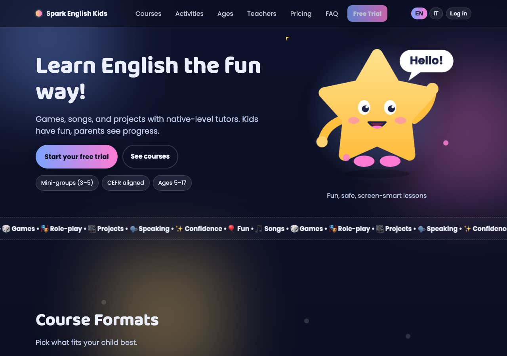
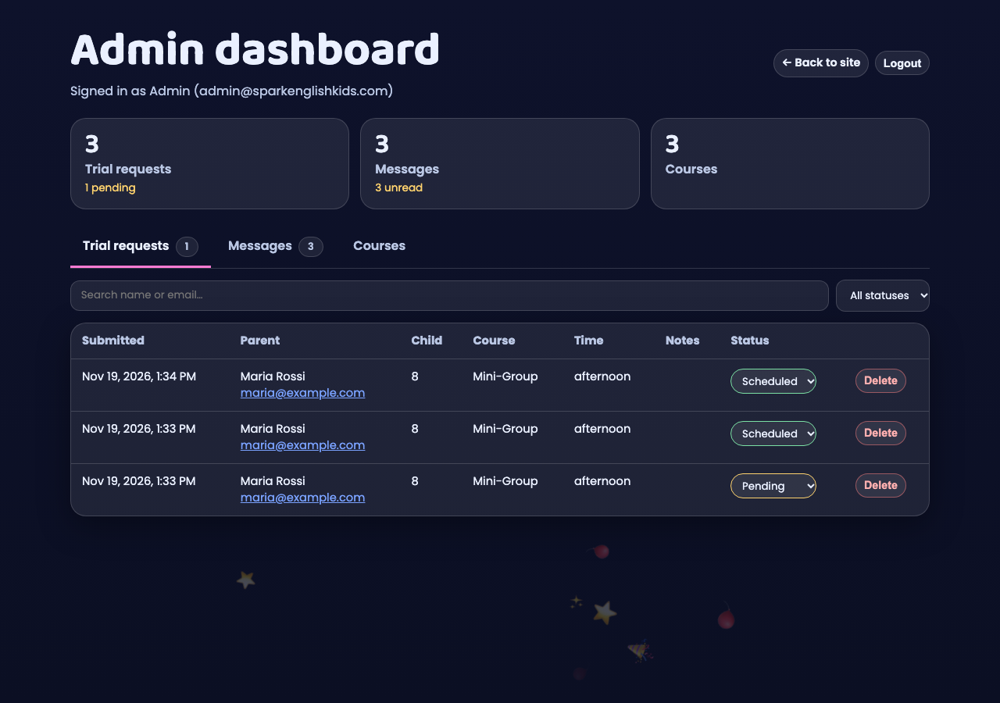
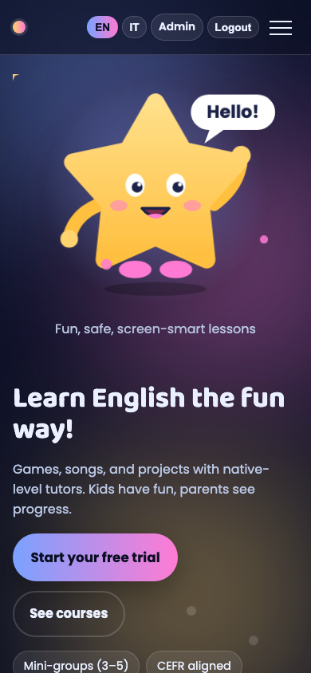

# Spark English Kids

A full-stack, bilingual (EN / IT) website for an online English school for children — marketing site, free-trial booking, contact form, user accounts and an admin dashboard.

| | |
|---|---|
|  |  |

**Live frontend:** https://spark-english-kids.netlify.app

## Tech

| Layer | Stack |
|---|---|
| Frontend | React 19, TypeScript (strict), Vite, React Router, TanStack Query, React Hook Form + Zod |
| Backend | C#, ASP.NET Core 8 Web API, EF Core 8, FluentValidation, JWT (role-based), BCrypt, Swagger/OpenAPI |
| Data | PostgreSQL (production, EF migrations) · SQLite (local dev / tests) |
| Quality | xUnit integration tests (`WebApplicationFactory`), GitHub Actions CI, Docker |

## Architecture

```
frontend/   React SPA ──HTTPS/JSON──▶  backend/ ASP.NET Core API ──EF Core──▶ PostgreSQL
                                          ├─ Domain          entities, enums
                                          ├─ Application     DTOs, interfaces, validators
                                          ├─ Infrastructure  DbContext, services, JWT, seeding, migrations
                                          └─ Api             controllers, middleware, rate limiting, Swagger
```

Highlights: role-based auth (Parent / Admin), server-side validation with RFC 7807 errors, per-IP rate limiting on public forms, paged + filterable admin lists, live course/schedule data driving the pricing section and trial form, graceful offline fallback in the UI, accessible dialogs and reduced-motion support.

## Run locally

```bash
# 1. API  (http://localhost:5128/swagger — dev admin: admin@sparkenglishkids.com / ChangeMe123!)
cd backend/src/SparkEnglish.Api && dotnet run

# 2. Web  (http://localhost:5173)
cd frontend && cp .env.example .env.local && npm install && npm run dev
```

Tests: `cd backend && dotnet test` · Postgres in Docker: see [backend/README.md](backend/README.md).

## Deploy

1. **Database:** create a free PostgreSQL project (e.g. Neon) and copy the connection string.
2. **API (Render):** New → Blueprint → select this repo ([`render.yaml`](render.yaml)). Set `ConnectionStrings__Default` and `Admin__Password`; `Jwt__Secret` is generated. Migrations run on boot.
3. **Web (Netlify):** set `VITE_API_BASE=https://<your-api>.onrender.com/api` and redeploy ([`frontend/netlify.toml`](frontend/netlify.toml)).
4. Make sure `Cors__Origins` on the API matches the Netlify URL.

See [backend/README.md](backend/README.md) and [frontend/README.md](frontend/README.md) for details.


# spark-English-platform
